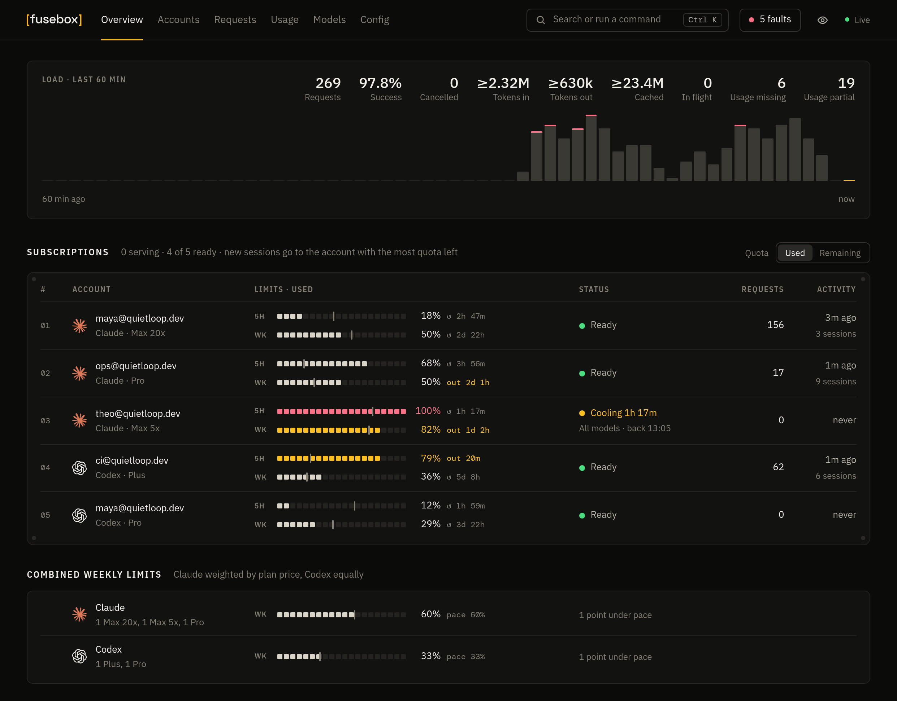
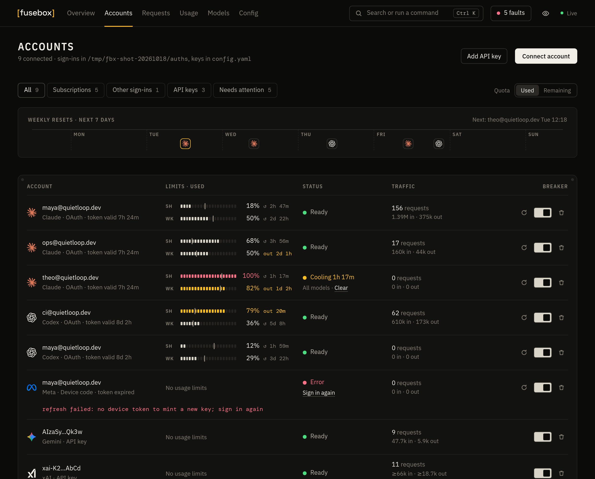
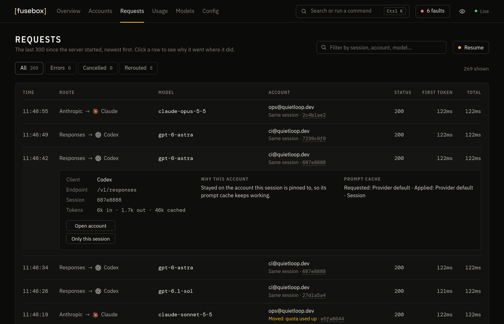
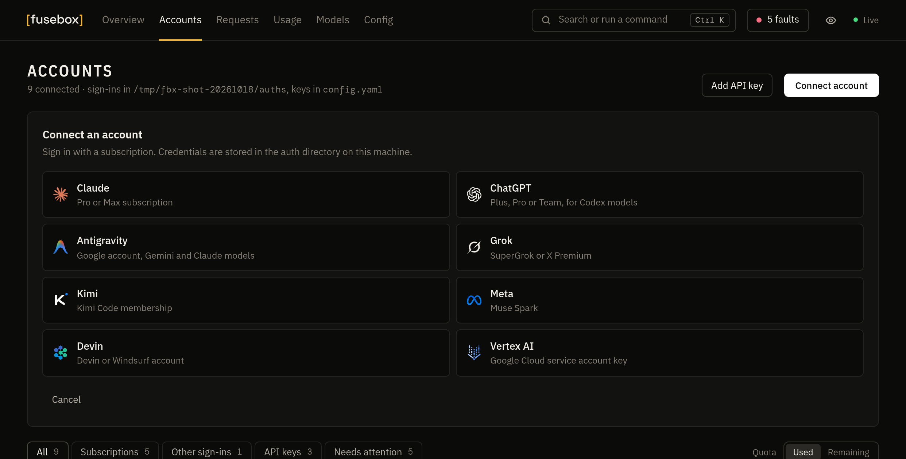

<div align="center">

<h1><picture><source media="(prefers-color-scheme: dark)" srcset="assets/fusebox-wordmark.svg"></picture></h1>

**All your AI subscriptions. One fast API.**

A single Rust binary that exposes OpenAI, Anthropic and Gemini compatible endpoints, backed by the accounts you already pay for:<br>
Claude, ChatGPT, Gemini, Antigravity, Grok, Kimi, Meta, Devin and Vertex AI.<br>
Point Claude Code, Codex, your editor or any SDK at one URL and stop caring which account answers.

[](https://github.com/DigitalPals/Fusebox/actions/workflows/ci.yml)
[](LICENSE)
[](https://www.rust-lang.org)
[](https://github.com/DigitalPals/Fusebox/releases/latest)
[](#the-dashboard)

[Quick start](#quick-start) · [Coming from CLIProxyAPI](#coming-from-cliproxyapi) · [Connect your tools](#connect-your-tools) · [Dashboard](#the-dashboard) · [Usage and costs](#usage-and-costs) · [Configuration](#configuration) · [FAQ](#faq)

</div>

<br>



<br>

## Why Fusebox

- **One small binary.** The dashboard and SQLite storage ship inside one executable. No Docker, no Node, no runtime to install.
- **Any model from any tool.** Use GPT inside Claude Code, Claude inside Codex, or Gemini behind the OpenAI SDK. Requests are translated between formats automatically. When the client and the provider already speak the same format, the request passes through untouched.
- **Ten providers.** Subscription sign-in for Claude, ChatGPT (Codex), Antigravity, Grok, Kimi, Meta and Devin; service accounts for Vertex AI; API keys for Anthropic, OpenAI, Gemini, Vertex, Kimi, xAI, Meta and anything OpenAI-compatible.
- **Images and video too.** `/v1/images/generations` and `/v1/images/edits` work with ChatGPT accounts, OpenAI and xAI keys, Vertex Imagen and Gemini image models. xAI video generation is behind `/v1/videos`.
- **WebSockets.** Codex WebSocket sessions are relayed to ChatGPT's own WebSocket upstream, so `previous_response_id` works on the server side. Switch to a Claude or Gemini model mid-session and Fusebox carries the conversation over.
- **Many accounts, no babysitting.** Each new coding session goes to the account with the most quota left, using the 5-hour and weekly usage Claude and ChatGPT report, and stays there so its prompt cache keeps paying off. An account whose limit is used up sits out until it resets, a rate limit cools down only that model on that account, failed requests move to the next account (even when the error arrives inside a stream that already started), and OAuth tokens refresh themselves.
- **Fallbacks and limits.** Model groups give one name to several models that take over from each other. Each tool can get its own key with its own models, request rate, daily tokens, monthly budget and end date.
- **A dashboard you'll actually open.** Live over WebSocket: every subscription's 5-hour and weekly limits as segmented meters with an even-pace mark, a warning when the pace would run a limit out early, what has tripped and why, an hour of load, cooldown timers, sign-in flows, a request log that explains each routing decision, the route order for every model, a playground, and a config editor that shows its changes before saving. Dark or light, in English or Chinese, and it works on a phone too.
- **Drop-in for CLIProxyAPI users.** Same credential files, same `config.yaml` (both of its layouts), same Docker paths and flags. Swap the image and keep everything else.

## Quick start

**1. Get the binary.** Download it for macOS, Linux or Windows from [Releases](https://github.com/DigitalPals/Fusebox/releases/latest). The Linux builds need glibc 2.36 or newer (Debian 12, Ubuntu 24.04 or later), and `gh attestation verify <archive> -R DigitalPals/Fusebox` confirms a download was built here. Or build it with Rust 1.88 or newer:

```sh
cargo install --git https://github.com/DigitalPals/Fusebox
```

Or run it with Docker (for amd64 and arm64):

```sh
touch config.yaml && mkdir -p auths
docker run -d --name fusebox -p 8317:8317 \
  -v ./config.yaml:/CLIProxyAPI/config.yaml -v ./auths:/root/.cli-proxy-api \
  ghcr.io/digitalpals/fusebox
```

**2. Start it.**

```sh
fusebox
```

The first run writes a commented `config.yaml` in the current directory (or wherever `--config` or `FUSEBOX_CONFIG` points) and serves everything on `http://127.0.0.1:8317`. That address is also the dashboard.

**3. Add an account.** Click **Connect account** in the dashboard, or use the terminal:

```sh
fusebox login claude        # Claude Pro / Max
fusebox login codex         # ChatGPT Plus / Pro / Team
fusebox login antigravity   # Google account with Antigravity
fusebox login xai           # SuperGrok / X Premium (shows a code to confirm)
fusebox login kimi          # Kimi Code (shows a code to confirm)
fusebox login meta          # Meta Muse (shows a code to confirm)
fusebox login devin         # Devin / Windsurf
fusebox login vertex --file key.json --location global   # Vertex AI service account
```

API keys (Anthropic, OpenAI, Gemini, Vertex, Kimi, xAI, Meta, OpenRouter, Ollama, …) can be added from the dashboard or in `config.yaml`.

## Coming from CLIProxyAPI

Your config, your sign-ins and your Docker setup carry over as they are.

**Docker.** Keep your `docker-compose.yml`, `config.yaml` and `auths/` folder. Add one line to the `.env` next to the compose file and restart:

```sh
echo "CLI_PROXY_IMAGE=ghcr.io/digitalpals/fusebox:latest" >> .env
docker compose up -d
```

The image uses the same paths (`/CLIProxyAPI/config.yaml`, `/root/.cli-proxy-api`) and port, and `./CLIProxyAPI` still works inside the container. To go back, delete the line.

**Binary.** Point it at your existing file: `fusebox --config /path/to/config.yaml`. CLIProxyAPI's flags work too: `-config`, `-claude-login`, `-codex-login`, `-antigravity-login`, `-kimi-login`, `-xai-login`, `-meta-login`, `-devin-login`, `-vertex-import`, `-no-browser`.

**Check before you switch.** This prints the accounts it found per provider, where it will listen, and any settings it will ignore, without starting the server:

```sh
fusebox --config config.yaml check
```

| From CLIProxyAPI | |
| --- | --- |
| Credential files in `auth-dir` | Read and written in the same format, for every provider |
| `config.yaml` | Both layouts: v8 (`server:`, `access:`, grouped `api-keys:`) and the older flat one |
| Client keys, management key (plain or bcrypt-hashed), `allow-remote`, TLS, proxy, routing strategy, retries | Used as is |
| API keys for Claude, Codex, Gemini, Vertex, xAI, Meta and OpenAI-compatible providers | Used with their `base-url`, `proxy-url` (including `direct`), `headers`, model aliases, `prefix` and `excluded-models` |
| `oauth-model-alias`, `oauth-excluded-models`, per-file `prefix` and `model_aliases` | Used as is |
| Session affinity (`routing.session-affinity` or `session-affinity`) | Supported and on by default, with any routing strategy. See [coding sessions](#coding-sessions-and-prompt-caching). |
| Payload rules, plugins, Redis usage queue, weighted routing, the `/v0/management` API | Not supported. The built-in dashboard replaces the separate management panel. |

Changes made from the dashboard keep your file's layout, YAML comments, and settings this binary doesn't use, so you can switch back at any time. The rare layout that can't be edited in place, such as lists written without indentation, is rewritten instead, and the original is kept as `config.yaml.bak`.

## Connect your tools

**Claude Code**

```sh
export ANTHROPIC_BASE_URL=http://127.0.0.1:8317
export ANTHROPIC_AUTH_TOKEN=<one of your api-keys, or anything if you set none>
claude
```

Want GPT in Claude Code? `export ANTHROPIC_MODEL=gpt-6-astra`.

**Codex** in `~/.codex/config.toml`

```toml
model = "gpt-6-astra"
model_provider = "fusebox"

[model_providers.fusebox]
name = "Fusebox"
base_url = "http://127.0.0.1:8317/v1"
wire_api = "responses"
env_key = "FUSEBOX_KEY"   # only needed if you set api-keys
```

**OpenAI SDK**, or any tool with a custom OpenAI base URL

```python
from openai import OpenAI

client = OpenAI(base_url="http://127.0.0.1:8317/v1", api_key="<key>")
client.chat.completions.create(
    model="claude-sonnet-5-5",
    messages=[{"role": "user", "content": "Hello"}],
)
```

**curl**

```sh
curl http://127.0.0.1:8317/v1/messages \
  -H "x-api-key: <key>" -H "content-type: application/json" \
  -d '{"model": "gemini-3.8-flash", "max_tokens": 512, "messages": [{"role": "user", "content": "Hello"}]}'
```

### Endpoints

| Endpoint | Speaks |
| --- | --- |
| `POST /v1/chat/completions` | OpenAI Chat Completions |
| `POST /v1/responses` · `GET /v1/responses` (WebSocket) | OpenAI Responses |
| `POST /v1/responses/compact` | Responses compaction (ChatGPT, xAI) |
| `POST /backend-api/codex/responses` (+ WebSocket) | Codex's native path |
| `POST /v1/messages` · `POST /v1/messages/count_tokens` | Anthropic Messages |
| `POST /v1beta/models/{model}:generateContent` · `:streamGenerateContent` | Gemini |
| `POST /v1/images/generations` · `POST /v1/images/edits` (JSON or multipart) | OpenAI Images |
| `POST /v1/videos/generations` · `/edits` · `/extensions` · `GET /v1/videos/{id}` | xAI video |
| `POST /v1/completions` | Legacy OpenAI completions |
| `POST /v1/embeddings` | OpenAI embeddings, from OpenAI, OpenAI-compatible, Gemini and Vertex keys |
| `GET /v1/models` · `GET /v1beta/models` | Model lists, model groups included |

Clients authenticate with `Authorization: Bearer`, `x-api-key`, `x-goog-api-key` or `?key=`.

Embeddings accept `encoding_format: float` (default) or `base64`; base64 encodes little-endian float32 values. Google adapters preserve input order, split Vertex batches to one text for Gemini embedding models or five for older text embedding models, and disable automatic truncation. A failed later chunk returns an error without replaying completed chunks; their usage is still recorded. Gemini embedding token counts are labelled estimates in the usage database. Models without a known price remain unpriced and cannot be treated as free by monthly budgets.

JSON API requests and multipart image edits support `Content-Encoding: gzip` or `zstd`, as well as uncompressed bodies. Authentication runs before decompression; both compressed and decoded bodies are limited to 256 MiB. Unsupported or stacked encodings return 415, malformed compressed bodies return 400, and oversized bodies return 413. Encoding and JSON validation failures appear in request statistics and logs without a provider attempt.

### Providers

| Provider | Sign-in | Models | Speaks upstream |
| --- | --- | --- | --- |
| Claude | OAuth (Pro / Max) or API key | `claude-*` | Anthropic Messages |
| Codex / ChatGPT | OAuth (Plus / Pro / Team) or OpenAI API key | `gpt-*`, `o*`, `codex-*`, `gpt-image-*` | Responses (+ WebSocket) |
| Gemini | API key | `gemini-*`, `gemma-*` | Gemini |
| Vertex AI | Service account or express API key | `gemini-*`, `imagen-*` | Gemini |
| Antigravity | Google OAuth | Gemini and Claude models such as `gemini-3.8-flash-high`, `claude-opus-4-6-thinking` | Cloud Code (Gemini) |
| Grok (xAI) | Device code (SuperGrok / X Premium) or API key | `grok-*`, `grok-imagine-*` | Responses |
| Kimi | Device code (Kimi Code) or API key | `kimi-*` | Chat, Anthropic or Responses, whichever the client speaks |
| Meta | Device code or API key | `muse-*` | Responses |
| Devin | OAuth (Devin / Windsurf) | Claude, GPT, Gemini, Grok, Kimi, GLM, DeepSeek and SWE models | Connect protobuf |
| OpenAI-compatible | API key or none (OpenRouter, Ollama, LM Studio, vLLM, …) | whatever you list, with optional aliases | Chat Completions |

Model names are forgiving: `gpt-6-1-sol` finds `gpt-6.1-sol`, and `gemini-3-8-flash` finds Antigravity's `gemini-3.8-flash-high` when that's the account you have.

When more than one provider has a model, the vendor's own accounts answer first and Antigravity or Devin take the overflow when those are rate limited. To choose a provider yourself, prefix the model: `antigravity/claude-sonnet-4-6`, `devin/gpt-6-astra`, `vertex/gemini-3.1-pro`.

### New models

A model a provider releases after your Fusebox version usually works straight away: requests go by name family, so `claude-*` reaches Claude, `gpt-*` reaches Codex, `gemini-*` Gemini, and so on.

Fusebox also asks the providers what they serve, so new models show up in `/v1/models` and on the dashboard by themselves. Signed-in Claude and Codex accounts each fetch their model list once every 6 to 7 hours, retrying after 15 minutes (then 30, 60, …) when that fails. The lists are kept in `<auth-dir>/.model-lists.state`, so a restart fetches nothing. Codex marks a changed list on its ordinary responses, which brings that account's next check forward, but never to within 10 minutes of the last one. Claude's list also says whether a model can turn thinking off and which effort levels it takes, and requests follow it. Antigravity has always fetched its own list.

For everything else (Gemini, Grok, Kimi, Meta, Devin, API keys), or when you don't want to wait, use **Add model** on the Models page, or the `+ Add` chip at the end of a family. It writes the model to `extra-models` in `config.yaml`:

```yaml
extra-models:
  claude: [claude-opus-6]
```

Every account of that provider then serves and lists it, apart from API keys with their own `models` list. Once a Fusebox release or the provider's model list includes it, Fusebox removes the entry from `config.yaml` and says so on the Models page. **Check Claude and Codex for new models** in the Add model form asks every signed-in Claude and Codex account now, skipping any checked in the last 10 minutes.

### Reasoning effort, from the model name

Append an effort level or a token budget to any model:

```text
gpt-6-astra(high)                  effort level
claude-opus-5-5(max)               adaptive thinking at max effort
claude-sonnet-4-5-20250929(16000)  thinking budget in tokens
gemini-2.5-pro(0)                  thinking off
```

### Images

```sh
curl http://127.0.0.1:8317/v1/images/generations \
  -H "authorization: Bearer <key>" -H "content-type: application/json" \
  -d '{"model": "gpt-image-2", "prompt": "a lighthouse at night, film photo", "size": "1536x1024"}'
```

`gpt-image-*` runs on a ChatGPT account through Codex's image tool (or an OpenAI key), `grok-imagine-*` on xAI, `imagen-*` on Vertex, and Gemini image models such as `gemini-3.1-flash-image-preview` on Gemini, Vertex or Antigravity. Image models also work in chat: the picture comes back as an image part in whatever format the client speaks.

## The dashboard

Everything is served from the binary at `/`, with no external requests.

<table>
<tr>
<td width="50%" valign="top"></td>
<td width="50%" valign="top"></td>
</tr>
<tr>
<td valign="top"><b>Accounts:</b> used or remaining 5-hour and weekly quota as segmented meters, token expiry, cooldowns per model, and a breaker for each account: refresh, switch off, remove. Each account has its own page with its hour of load and the coding sessions pinned to it.</td>
<td valign="top"><b>Requests:</b> every request as it happens, showing which client format went to which provider, time to first token and tokens. Click a row to see why it went to that account; click a session to follow it.</td>
</tr>
<tr>
<td colspan="2"></td>
</tr>
<tr>
<td colspan="2"><b>Connect anything:</b> browser sign-in, device codes for Grok, Kimi and Meta, or a Vertex service account key. On a server, approve in your browser and paste the redirect URL it lands on. The dashboard also works on a phone.</td>
</tr>
</table>

The **Models** tab groups every model id by family, shows aliases and model groups, and lists the order in which accounts would take a new session, with the next one marked. **Try a model** sends a prompt through routing like any request and shows which account answered and how fast.

Each quota meter has a thin mark where usage would be if spread evenly over the window. When the pace so far would use a window up before it resets, the meter says when (`out 1h 40m`). The Accounts page lines up every subscription's next weekly reset over seven days, and each account page sets whether it takes new sessions **First**, **Normal** or **Last**.

Sharing a screenshot or your screen? The eye button in the top bar (or <kbd>.</kbd>) hides every email and API key on the page, and copy buttons still copy the real values.

Choose **Used** or **Remaining** beside the quota meters (or press <kbd>U</kbd>); your browser remembers it. Each meter has 20 segments of 5%: they light up off-white while there's room, amber from 75% used and red from 95%.

<kbd>⌘K</kbd> / <kbd>Ctrl K</kbd> or <kbd>/</kbd> opens a command palette for accounts, models and actions such as connecting an account, clearing cooldowns, switching between light, dark and the system's theme, or switching between English and Chinese (the dashboard follows the browser's language until you pick one). The faults button in the top bar lists what has tripped: expired sign-ins, used-up limits, rate limits and runs of failed requests. Other tools can read the same list from the management API ([details](docs/notifications.md#reading-faults-from-other-tools)).

**Install it as an app, with notifications.** Over HTTPS (or on `localhost`) the dashboard installs like an app: from Chrome or Edge's install button, Safari's **Add to Dock**, or **Add to Home Screen** on a phone. It opens in its own window, shows the number of faults on its icon, and can send push notifications when a sign-in expires or every account of a provider is used up (and when one is back). Turn them on per device under **Config, Notifications** and choose the events there. See [notifications](docs/notifications.md).

**Banked resets** (off by default). Claude and ChatGPT sometimes give subscribers saved resets that clear a usage limit early. Turn on `banked-resets` (Config, Connections) and subscriptions that have some show “↻ 2 resets banked” under their status; click it to see expiry dates and spend one with confirmation. Smart quota balancing prefers accounts with a reset expiring within seven days. Automatic use is separately opt-in under Config, Routing and shares the crash-safe reset journal. See [banked resets](docs/banked-resets.md).

<sub>Screenshots use sample data.</sub>

## Usage and costs

The Usage page records proxy-reported tokens and can import metadata from opted-in Claude Code and Codex histories, including from a standalone collector on another machine. Source totals stay separate when histories may overlap. USD figures are local API list-price estimates; subscription quota meters remain separate and are never presented as API bills. See [Usage and costs](docs/usage-costs.md) for configuration, source coverage, privacy, import and collector setup, reconciliation limits, and SQLite backup and recovery.

Retiring an older Redis-based usage collector requires a compatible replacement and a database backup; see [production log follow-up](notes/production-log-followup.md). Fusebox's native usage capture replaces that ingestion path.

## Configuration

`config.yaml` reloads automatically when it changes, and the dashboard edits the same file.

The dashboard's Config page starts with **Clients**, the endpoint and key with copyable setup for Claude Code, Codex, OpenCode, the OpenAI SDK and curl, and under **More tools** for Gemini CLI, Aider, Continue, Zed, Cline and Roo Code, and Cursor. Then come forms for server and access settings, routing, connections, provider keys, model rules, notifications and diagnostics, plus a **YAML file** section for everything else. Every save first shows the lines it changes in `config.yaml`. Keys stay masked until revealed, and leaving an existing key blank keeps it unchanged. If the file changes elsewhere while you edit, the page asks you to reload before saving. Bind address, port, HTTPS, debug logging and log format changes need a restart; the page shows which are pending.

**Named clients** (`named-clients`) give each tool its own key and a label, so the Usage page shows which tool sent what. Add and remove them under Config, Clients; other tools, such as Whombat, can add their own with the management key. **Limits** on a client, each optional, refuse what it may not do with a clear error:

```yaml
named-clients:
  - id: laptop
    label: Work laptop
    key: fbx_...
    models: [claude-*, gpt-6-astra]   # model patterns it may ask for
    user-agents: [claude-cli/*]       # programs it may use (User-Agent patterns)
    requests-per-minute: 60           # over it: 429 with Retry-After
    tokens-per-day: 5000000           # input, cache writes and output; cache reads don't count
    usd-per-month: 100                # estimated at API list prices (needs the usage database)
    expires: 2026-12-31               # the last day the key works, server time
```

Days and months follow the server's time zone. Completed provider attempts update tokens and estimated spend immediately; every 30 seconds, Fusebox reconciles those totals with the usage database. Concurrent requests can still run slightly past a limit. Budget-limited keys receive 503 if accounting is unavailable, incomplete, or more than 90 seconds old, including while the initial totals load. Unknown prices are never counted as zero spend. WebSocket opening handshakes are free; each turn counts toward the request rate. Config, Clients shows each client's use beside its limits, and `GET /api/clients/usage` returns it.

```yaml
host: "127.0.0.1"             # 0.0.0.0 to expose it (set api-keys first)
port: 8317
auth-dir: "~/.fusebox"        # OAuth credential files (CLIProxyAPI's work too)
api-keys: ["fbx_pick-anything"] # keys your clients must send; empty = open
management-key: ""            # empty = dashboard only from localhost
proxy-url: ""                 # optional http://, https:// or socks5:// upstream proxy; never falls back to direct
request-retry: 3              # account/model choices across the whole request (at most 10)
first-token-timeout-seconds: 120 # a stream silent this long moves to the next account; 0 = off
routing: least-used           # new sessions: most quota left; or smart-quota, round-robin, fill-first
session-affinity: true        # keep each coding session on one account, for prompt caching
session-affinity-idle-seconds: 86400 # forget assignments after a day without requests
codex-websockets: true        # native WebSocket relay to ChatGPT
claude-cloak: true            # present non-Claude-Code clients as Claude Code on OAuth accounts
banked-resets: false          # show and spend banked Claude/ChatGPT limit resets (unofficial endpoints)
tls:                          # serve HTTPS directly (or put a proxy in front, see below)
  enable: false
  cert: "/etc/fusebox/cert.pem"
  key: "/etc/fusebox/key.pem"
notifications:                # push notifications, for devices that turn them on
  sign-in-expired: true
  provider-exhausted: true    # every account of a provider is out, and when one is back
  account-used-up: false
  account-errors: false
  webhooks:                   # the same messages in Discord, Slack, Teams, Telegram, ntfy or any URL
    - https://discord.com/api/webhooks/...
log-format: text              # or json, one object per line (needs a restart)
model-groups:                 # one name, several models; see "Model groups" below
  smart: [claude-opus-5-5, gpt-6-astra]
background-model: gemini-3.8-flash # Claude Code's quick Haiku calls go here

claude-api-key:
  - api-key: "sk-ant-..."
codex-api-key:
  - api-key: "sk-..."
    priority: -10             # only when the accounts above it can't (sign-ins: "priority" in their file)
gemini-api-key:
  - api-key: "AIza..."
vertex-api-key:               # Vertex express mode (service accounts go in auth-dir)
  - api-key: "AQ..."
kimi-api-key:
  - api-key: "sk-kimi-..."    # Kimi Code; Moonshot platform keys need base-url
xai-api-key:
  - api-key: "xai-..."
meta-api-key:
  - api-key: "..."
openai-compatibility:
  - name: openrouter
    base-url: "https://openrouter.ai/api/v1"
    api-keys: ["sk-or-..."]
    models:
      - name: "moonshotai/kimi-k3"
        alias: "kimi-k3"
  - name: ollama
    base-url: "http://127.0.0.1:11434/v1"
    models:
      - name: "qwen3-coder:30b"
```

### Model groups and the background model

A model group is one name for several models. Clients ask for the group as they would for a model, and it is listed by `/v1/models`. Each model takes over when the one before it can't answer: no account serves it, every account is rate limited or used up, or the provider fails. A bad request (a prompt too long, say) is answered at once instead. Name a group after a real model to give that model fallbacks:

```yaml
model-groups:
  claude-opus-5-5: [claude-opus-5-5, gpt-6-astra]   # Opus, then GPT when every Claude account is out
  fast: { models: [claude-sonnet-5-5, gemini-3.8-flash], balance: true }
```

With `balance: true`, new sessions start on different models instead of always the first; a session keeps its model, so its prompt cache keeps working. A group's models are always models, never other groups.

`background-model` sends Claude Code's quick background calls (it asks its Haiku model for titles, summaries and checks) to another model or group, to keep them off your subscription's limits. Other clients asking for Haiku get Haiku.

### Account priority

Every account has a priority, 0 unless set. New sessions go to the highest priority with an account ready; the routing strategy chooses among those, and lower priorities only take over when none of them can. Set it on the account's page (**First**, **Normal** or **Last**), as `priority` on an API key in `config.yaml`, or as `"priority"` in a sign-in's credential file, as CLIProxyAPI does. Sessions already on an account stay there.

### When a request fails

A request tries up to `request-retry` account/model choices and at most ten attempts, including temporary retries on the same account. These limits and the two-minute retry budget cover every model in a model group together. A connection that never opened gets one more try on the same account; one that broke after the request went out moves to the next account, so the same account never runs it twice. An upstream HTTP 504 is answered, including in a model group, because the provider may still be working on it.

Streams are held back until their first content, at most 5 seconds after they start. A rate limit or overload that arrives inside a successful response before then moves the request to the next account, and the client never sees it. A stream that sends nothing at all for `first-token-timeout-seconds` (120 by default) moves too, and that account sits out the model for two minutes.

Rate limits and used-up limits are kept in `.cooldowns.state` in the auth directory, so a restart doesn't send requests straight back to an account that is sitting out.

### Coding sessions and prompt caching

Requests from one coding session stay on the account the session started on, so the provider's prompt cache keeps working. `routing` picks the account for each new session. A session moves only when its subscription runs out of quota, or its account is disabled, removed or can't serve the model, and the replacement then keeps it. When its account is only busy (a rate limit, an overload, a failed attempt), that request is answered by another account and the session goes back afterwards. Turn this off with `session-affinity: false` (`routing.session-affinity` in a CLIProxyAPI v8 file).

**Smart quota balancing** (`routing: smart-quota`, or **Config → Routing → Account selection**) first prefers valid banked resets nearing expiry (when enabled), then concentrates new sessions on the account whose weekly limit renews first, so allowance that would expire unused gets used first. Many sessions can share that account: load only affects selection between accounts renewing within an hour of the earliest reset. For example, accounts renewing in two, three and four days receive new sessions in that order, even if the three-day account has only 16% weekly quota left.

Reserves protect existing work. When an account has an in-flight request or a session used in the last five minutes, prefer other accounts for new sessions below the configured **5-hour reserve** or 5% applicable weekly quota remaining. An idle account may admit a new session below either reserve to drain its allowance; subsequent new sessions then protect that session's remaining quota. Existing sessions keep their account until actual quota exhaustion or account unavailability. Explicit session completion releases the reservation immediately, and older saved assignments preserve affinity without reserving quota indefinitely. When every account needs its reserve, or no eligible future weekly reset is known, quota and load decide rather than refusing available allowance.

```yaml
routing: smart-quota
five-hour-reserve-percent: 30 # 0 turns the reserve off; other strategies ignore it
```

In a v8 file both go under `routing` (`strategy: smart-quota`).

Sessions are recognised from what clients already send: Claude Code's session metadata, Codex's `session_id` and `thread-id` headers, a Responses `conversation` id or `prompt_cache_key`. Writing your own client? Send one stable `x-fusebox-session-id` per task (the older `x-cliproxy-session-id` still works). Each client API key has its own sessions. A WebSocket without any of these keeps its account for the connection.

An HTTP request without any of them is recognised by its conversation's first user message, which every turn repeats, so the conversation's turns still share one account and its prompt cache. Cache markers are ignored for this, since clients move them from turn to turn. Conversations that start with the same message share an account. These inferred assignments are written to disk in the background and forgotten after an hour without requests, when no provider cache would still be warm. The Requests page marks them as **Inferred session**. A request with no user message at all is routed on its own.

Assignments are saved to `.routing-sessions.state` in the auth directory (hashed ids, owner-only permissions), so they survive restarts, and forgotten after `session-affinity-idle-seconds` without requests (a day by default). Send `x-fusebox-session-end: true` (or `x-cliproxy-session-end: true`) with a task's last request to release it early. Responses history for `previous_response_id` is kept in memory only, up to 64 MiB. Run one proxy per auth directory.

The Requests page shows each request's session fingerprint (click it to see the whole session), why its account was chosen, and its cached tokens.

Cache hints carry across formats: OpenAI cache settings and breakpoints between Chat Completions and Responses, and Claude's cache markers, in their TTL order, when a request is made to look like Claude Code. A hint that can't be carried over is dropped rather than failing the request.

Requests translated to Anthropic use its automatic prompt caching when the caller has not supplied explicit cache controls. So do requests that are made to look like Claude Code on a subscription account, which also cache the shared tools and system prompt. This covers the growing conversation, including caller instructions moved by OAuth cloaking. Explicit controls take precedence; cache hits still depend on the provider's minimum prompt size and reuse within its cache lifetime.

OpenAI routes its prompt cache by a `prompt_cache_key`, which Codex always sends. Requests to ChatGPT accounts or to OpenAI's own API that arrive without one, including Claude-format requests translated for a GPT model, get a key derived from their session. xAI receives the same key as its conversation id. A key the client sends is passed on unchanged, and API keys with a custom `base-url` never get one added.

The Requests page and structured completion logs show the requested and applied cache controls, derived key scope, and any translation downgrade. These describe what Fusebox sent; provider usage determines whether a cache was actually used. Defaults preserve the behavior above. Optional controls are available under Routing in the dashboard or in YAML:

```yaml
prompt-cache:
  scope: session          # session | client | workspace
  namespace: ""           # optional prompt/tool schema version, at most 256 bytes
  on-incompatible: drop   # drop | automatic | reject
```

`client` shares a derived key across sessions authenticated by the same client key. `workspace` also includes the `x-fusebox-cache-workspace` header (1–1024 bytes after trimming); absent or invalid headers fall back to session scope. Unauthenticated requests share one client scope. A nonempty namespace versions derived keys in any scope. Shared scopes do not alter account affinity, so cache reuse still depends on the selected account and provider. Caller-supplied keys always take precedence, and workspace names and raw cache keys are excluded from policy diagnostics. Native Codex WebSockets use the same derivation as HTTP.

`drop` discards incompatible hints while preserving compatible fields and the caller's explicit caching intent. `automatic` opts into automatic caching on the Claude provider when translation loses explicit boundaries. Explicit mode without boundaries remains uncached; TTLs are not translated. `reject` returns `400` before sending a request with incompatible hints. Unsupported prewarming remains an error in every mode. See [context efficiency](docs/context-efficiency.md) for measuring cache reuse and latency with stable prefixes.

HTTP POST body limits apply to both encoded and decoded bytes. The defaults retain 256 MiB per request. Optional admission limits cover body collection, provider work and response streaming, returning `503` with `Retry-After: 1` when full:

```yaml
request-limits:
  text-body-bytes: 268435456
  media-body-bytes: 268435456
  max-in-flight: 0
  max-in-flight-body-bytes: 0
```

Body limits must be 1–268435456 bytes. `media-body-bytes` applies to `/v1/images/*` and `/v1/videos/*`; other API POST routes, including multimodal Gemini calls, use `text-body-bytes`. Zero disables each aggregate limit. The byte budget counts decoded request bodies through response completion and releases reservations on errors or cancellation. It bounds body bytes, not total RSS: parsed JSON, histories and responses need additional memory. Admission is fail-fast and process-wide; WebSockets and management routes are separate. These settings reload for new requests without a restart and are available under Connections in the dashboard.

Output limits are preserved during translation. Manual Claude thinking needs an output limit greater than 1,024 tokens; incompatible requests receive a `400` instead of silently increasing the limit. Gemini reasoning suffixes use the same mapping for native and translated requests.

Token-count responses include `x-fusebox-token-count-estimated: false` when Claude supplies a count, or `true` for the local fallback. The fallback estimates text and tool schemas and uses fixed allowances for media; it does not count base64 data as text. Media dimensions, document length and audio/video duration can change the real count, so use provider usage for accounting.

An upstream stream that ends before its completion event returns an error, retaining any usage received. Closing a client WebSocket cancels its active turn; a client that stops reading is disconnected after a bounded write wait. Session assignments are saved by a background writer, with new assignments persisted before the provider request starts.

The dashboard separates cancelled requests from failures. Missing usage appears as unknown, and partial usage is a lower bound. Request logs retain safe failure categories, transport, timing, attempts and usage completeness without recording upstream error bodies. To measure whether smaller contexts help your workload, use the opt-in [context comparison benchmark](docs/context-efficiency.md); Fusebox does not silently rewrite prompts.

### Running it on a server

Set `host: "0.0.0.0"`, an `api-keys` entry for your clients, and a `management-key` for the dashboard. In Docker the dashboard also needs a `management-key`, because browser requests reach the container from outside `localhost`. Then keep it running, for example with systemd:

```ini
# /etc/systemd/system/fusebox.service
[Unit]
Description=Fusebox
After=network-online.target

[Service]
ExecStart=/usr/local/bin/fusebox --config /etc/fusebox/config.yaml
Restart=always
TimeoutStopSec=90s

[Install]
WantedBy=multi-user.target
```

To sign in accounts on a server, open the dashboard, click **Connect account**, approve in your browser, then paste the `localhost` URL the browser lands on (it won't load, which is expected). Grok, Kimi and Meta use device codes, so they work from anywhere with nothing to paste. `fusebox login <provider>` on the server works the same way.

On Ctrl-C or SIGTERM, Fusebox stops taking connections, tells open WebSockets to reconnect, and gives requests in flight up to 10 seconds before it saves sessions, cooldowns and the usage database, well inside `TimeoutStopSec`.

**Keeping an eye on it.** `GET /healthz` answers while the process runs. `GET /readyz` answers 200 when at least one account can take requests and the usage database works, and 503 with the reason otherwise. `GET /metrics` serves Prometheus metrics (requests, tokens, each account's readiness, load and quota windows, faults, client spend), with the dashboard's authentication: from localhost, or with the management key as a bearer token:

```yaml
scrape_configs:
  - job_name: fusebox
    metrics_path: /metrics
    authorization: { credentials: "<management-key>" }
    static_configs: [{ targets: ["127.0.0.1:8317"] }]
```

`log-format: json` (or `FUSEBOX_LOG_FORMAT=json`) writes one JSON object per line for log collectors. `fusebox usage backup ~/usage-backup.sqlite3` copies the usage database safely while Fusebox runs and checks the copy. `fusebox --version` names the commit it was built from.

**Docker without root.** The `-nonroot` tags (`ghcr.io/digitalpals/fusebox:latest-nonroot`) run as uid 65532 instead of root. Mount the config at `/home/nonroot/config.yaml` and sign-ins at `/home/nonroot/.fusebox`, owned by that uid:

```sh
mkdir -p auths && touch config.yaml && sudo chown -R 65532 auths config.yaml
docker run -d --name fusebox -p 8317:8317 -e FUSEBOX_DEFAULT_HOST=0.0.0.0 \
  -v ./config.yaml:/home/nonroot/config.yaml -v ./auths:/home/nonroot/.fusebox \
  ghcr.io/digitalpals/fusebox:latest-nonroot
```

The default tags keep CLIProxyAPI's layout (root, `/CLIProxyAPI`), so they stay a drop-in.

### HTTPS with Tailscale, nginx or Caddy

Installing the dashboard as an app and push notifications need HTTPS. Either give Fusebox a certificate (`tls` in the config above) or keep it on `127.0.0.1` and put an HTTPS proxy in front. **Behind any proxy, set a `management-key`:** a proxy on the same machine connects from `127.0.0.1`, which Fusebox would otherwise trust as local. Fusebox recognises Tailscale, nginx and Caddy by the `X-Forwarded-For` header they add and asks them for the key, but a proxy that forwards raw TCP adds nothing. Set `api-keys` too, unless everyone who can reach the proxy may use your accounts.

What Fusebox trusts by address alone (the dashboard without a `management-key`, the proxy without `api-keys` on `127.0.0.1`) is refused to web pages: a request whose `Origin` names another site, or that arrives directly with a `Host` naming anything other than this machine, gets a 403, so a site you visit can't reach your accounts or settings. Tools on this machine, and pages served from `localhost`, are unaffected. Five wrong management keys lock that address out, from 30 seconds doubling up to 15 minutes.

**Tailscale.** With [HTTPS certificates](https://tailscale.com/kb/1153/enabling-https) enabled for your tailnet, this serves Fusebox at `https://<machine>.<tailnet>.ts.net` to your tailnet only:

```sh
tailscale serve --bg 8317
```

If Fusebox itself serves HTTPS with its own certificate, point Tailscale at it with `tailscale serve --bg https+insecure://127.0.0.1:8317`. `tailscale funnel` would put the dashboard on the public internet; don't, unless you mean to.

**nginx.** Pass websocket upgrades (the dashboard's live view, Codex), don't buffer streamed responses, and allow long streams and large requests:

```nginx
server {
    listen 443 ssl;
    server_name fusebox.example.com;
    ssl_certificate     /etc/letsencrypt/live/fusebox.example.com/fullchain.pem;
    ssl_certificate_key /etc/letsencrypt/live/fusebox.example.com/privkey.pem;

    location / {
        proxy_pass http://127.0.0.1:8317;
        proxy_http_version 1.1;
        proxy_set_header Upgrade $http_upgrade;
        proxy_set_header Connection $connection_upgrade;
        proxy_set_header Host $host;
        proxy_set_header X-Forwarded-For $proxy_add_x_forwarded_for;
        proxy_set_header X-Forwarded-Proto $scheme;
        proxy_buffering off;
        proxy_read_timeout 600s;
        proxy_send_timeout 600s;
        client_max_body_size 256m;
    }
}

# in the http block:
map $http_upgrade $connection_upgrade { default upgrade; '' close; }
```

**Caddy** gets a certificate and handles all of that by itself:

```caddy
fusebox.example.com {
    reverse_proxy 127.0.0.1:8317
}
```

The dashboard sends its key in the live view's URL (browsers can't set headers on a websocket), so it can appear in the proxy's access log; keep that log private or turn it off for this site.

## How it works

```text
client request ──parse──▶ shared request model ──build──▶ provider request ──▶ upstream
client stream  ◀─render── shared event stream  ◀─parse─── provider stream  ◀──┘
```

Each wire format (`src/formats/{chat,responses,claude,gemini}.rs`) knows how to parse requests, build requests, decode streams and render streams. Adding a format means writing four functions instead of a translator for every pair.

| File | What it does |
| --- | --- |
| `src/proxy.rs` | Picks an account, translates, retries on the next account, streams back, records usage |
| `src/ws.rs` | Responses over WebSocket: native Codex relay, or local history for other providers |
| `src/upstream.rs` | Per-provider URLs and headers, including the request shape Claude OAuth accounts expect |
| `src/accounts.rs` | Credential files, API keys, routing, priority and cooldowns |
| `src/policy.rs` | Named clients' limits: models, programs, rate, tokens, spend, expiry |
| `src/embeddings.rs` | `/v1/embeddings` on OpenAI, compatible, Gemini and Vertex keys |
| `src/metrics.rs` | `/readyz` and Prometheus `/metrics` |
| `src/push/` | Faults, push notifications and webhooks |
| `src/oauth.rs` · `src/device.rs` | Browser and device-code sign-in, token refresh for every provider |
| `src/antigravity.rs` · `src/schema.rs` | Cloud Code envelope, project onboarding and the JSON Schema down-leveller it needs |
| `src/devin.rs` | Devin's Connect protobuf: request encoding, stream decoding, model ids |
| `src/vertex.rs` | Service account JWT signing |
| `src/media.rs` | Image, video and compaction endpoints |
| `src/compat.rs` | CLIProxyAPI's config layouts, in-place config edits and command-line flags |
| `ui/` | The dashboard: plain HTML, CSS and JS, compiled into the binary |

## Compared with CLIProxyAPI

Fusebox is a smaller rewrite of [CLIProxyAPI](https://github.com/router-for-me/CLIProxyAPI), not a port.

| | Fusebox | CLIProxyAPI |
| --- | --- | --- |
| Language | Rust, one binary | Go |
| Dashboard | Built in | Separate web panel |
| Codex WebSockets | Yes, native relay | Yes |
| Claude, ChatGPT, Antigravity, Grok, Kimi, Meta, Devin sign-in | Yes | Yes |
| Vertex service accounts, API keys, OpenAI-compatible | Yes | Yes |
| Images, xAI video, Responses compaction | Yes | Yes |
| Go plugins, Redis usage queue | No | Yes |
| Credential files, config, Docker image layout, CLI flags | Compatible with CLIProxyAPI's | — |

Plugins are Go shared libraries loaded into CLIProxyAPI's process, and the Redis queue feeds its separate usage service. Neither applies to a single Rust binary that keeps its own stats.

## FAQ

**Is this allowed?** Fusebox is not affiliated with Anthropic, OpenAI, Google, xAI, Moonshot, Meta or Cognition. Using subscription accounts through third-party tools may be against a provider's terms, and providers can rate-limit or suspend accounts. You are responsible for how you use it.

**Does it work with my CLIProxyAPI setup?** Yes. See [Coming from CLIProxyAPI](#coming-from-cliproxyapi): credential files, both config layouts, the Docker image paths and the command-line flags all carry over. Run `fusebox check` to see exactly what it picks up.

**Where are my credentials stored?** In `auth-dir`, one JSON file per account, replaced atomically and readable only by you (`0600`) from the moment it is written. On Windows, files take the permissions of their folder, so keep `auth-dir` inside your user profile, which other users can't read. It defaults to `~/.fusebox`; if that doesn't exist but `~/.cli-proxy-api` (CLIProxyAPI's directory, and this project's before it was renamed) does, that one is used and the server says so at startup. Setting `auth-dir` always wins. Nothing leaves your machine except requests to the providers you use.

**Does it phone home?** No. There is no telemetry and the dashboard loads no external assets. If you turn on notifications, Fusebox sends end-to-end encrypted messages to your browser's push service (Google, Mozilla or Apple), which delivers them to your device, and plain messages to the webhooks you add; nothing else.

**Claude sign-in fails or gets blocked.** Some Anthropic endpoints sit behind bot protection that CLIProxyAPI works around with a browser TLS fingerprint. Fusebox uses standard rustls. If token exchange fails for you, please open an issue with the error from the dashboard.

**Are usage stats saved?** The Usage page uses a durable SQLite database by default. The overview's live counters, minute charts and last 300 request details reset on restart. Missing provider usage remains unknown; see [Usage and costs](docs/usage-costs.md) for coverage, retention and backup details.

**I used this project when it was called CLIProxyAPI-Rust.** Everything keeps working. The old `CLIPROXYAPI_RUST_CONFIG` and `CLIPROXYAPI_RUST_DEFAULT_HOST` variables are still read (the new names are `FUSEBOX_CONFIG` and `FUSEBOX_DEFAULT_HOST`), the `x-cliproxy-*` session headers are still accepted, `~/.cli-proxy-api` is still found, and the dashboard moves its saved preferences over. Rename the binary in your scripts from `cliproxyapi-rust` to `fusebox`, and Codex's `env_key` to `FUSEBOX_KEY` if you like.

## Development

```sh
cargo test            # translator and protocol tests
cargo clippy --all-targets
cargo run -- --config dev.yaml
```

The dashboard lives in `ui/`. Its text assets are compressed and embedded at build time, so rebuild after editing them.

### Client versions

Requests Fusebox builds for other clients look like one release of Claude Code, the Codex CLI, Grok Build, Muse Code, the Devin CLI and Antigravity. Those releases are listed in `.github/client-versions.json`, and `cargo test` checks the code says the same. Every morning the **Client versions** workflow compares them with each client's latest release and keeps one issue (label `client-version`) open per client that is behind, closing it once Fusebox catches up. To catch up, check what the new release sends, update the code to match, and bump the version in both places.

Real Claude Code and Codex clients keep their own identity on the way through, and Fusebox's own small requests (usage, model lists) say they come from the newest Claude Code or Codex release your clients use.

See [release binary size](docs/binary-size.md) for compiler comparisons, measured
savings, and Linux packed-relocation compatibility.

### Releases

Pushing a version tag publishes a release. Bump `version` in `Cargo.toml` and `Cargo.lock`, merge that to main, then tag it:

```sh
git tag -a v0.4.1 -m v0.4.1 && git push origin v0.4.1
```

The **Release** workflow checks that the tag matches `Cargo.toml`, builds the five archives and publishes them with `SHA256SUMS`, build attestations and a list of the pull requests since the last release, below `.github/release-notes/v0.4.1.md` if that file exists. A tag such as `v0.4.1-rc.1` publishes a prerelease. If the workflow itself fails, fix it on main and release the existing tag with `gh workflow run release.yml -f tag=v0.4.1`, rather than moving the tag. The **Docker** workflow tags the image `0.4.1`, `0.4` and `latest`; a prerelease gets only its own tag.

Patch releases bring client-version catch-ups and fixes; minor releases bring features, new settings and changed behaviour.

## Credits

Fusebox started as [CLIProxyAPI-Rust](https://github.com/IuCC123/CLIProxyAPI-Rust) by [IuCC123](https://github.com/IuCC123), who wrote the original Rust rewrite and dashboard. That project was in turn a rewrite of [CLIProxyAPI](https://github.com/router-for-me/CLIProxyAPI) by router-for-me. Thanks to both.

## License

[Unlicense](LICENSE): public domain. Copy it, change it, sell it, ship it, no attribution required.

The provider logos in `ui/logos.svg` come from [LobeHub Icons](https://github.com/lobehub/lobe-icons) (MIT, notice included in the file) and are trademarks of their owners.

<br>

<div align="center"><sub>Based on <a href="https://github.com/IuCC123/CLIProxyAPI-Rust">CLIProxyAPI-Rust</a> by IuCC123 and inspired by <a href="https://github.com/router-for-me/CLIProxyAPI">CLIProxyAPI</a>. Created in <a href="https://t3.codes">T3 Code</a>.</sub></div>
