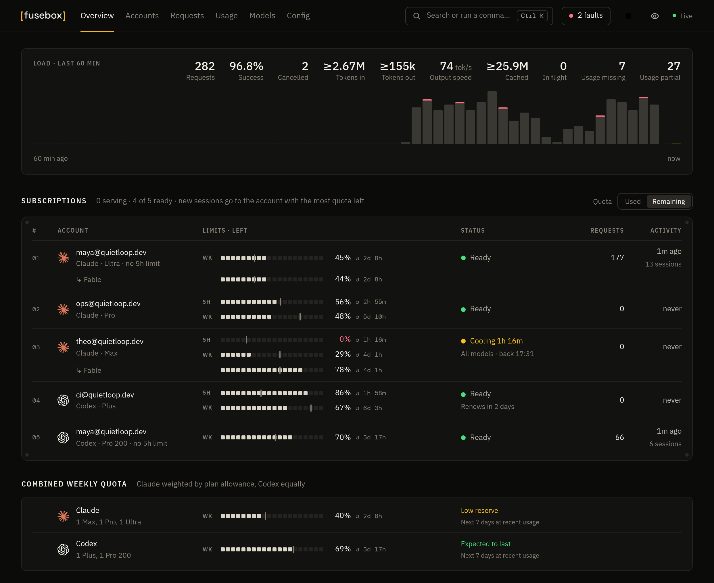
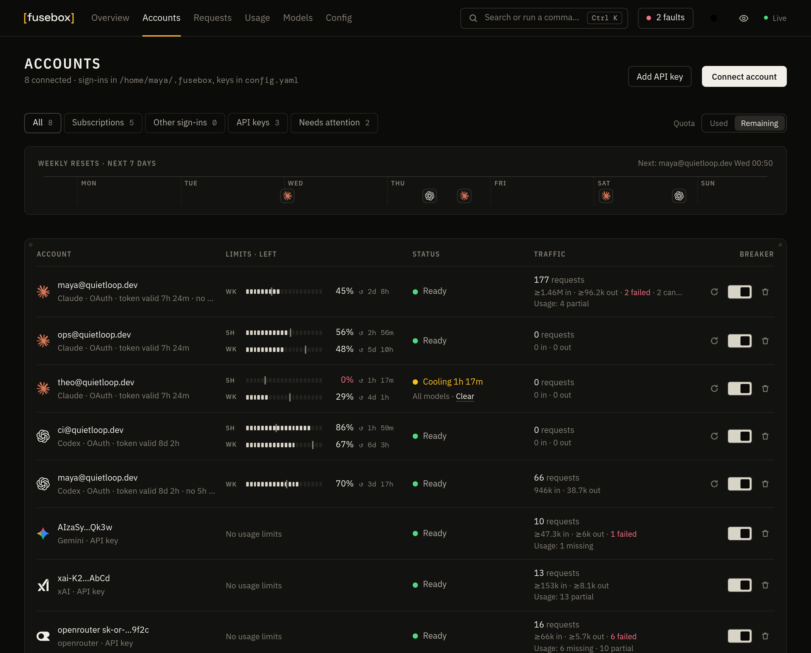
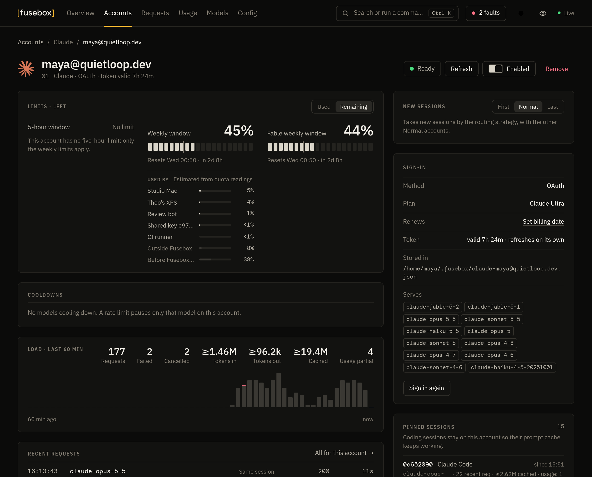
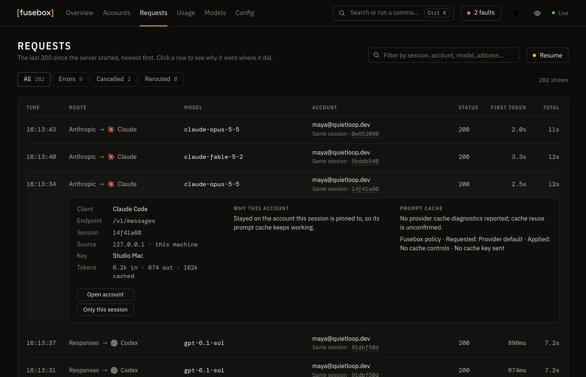
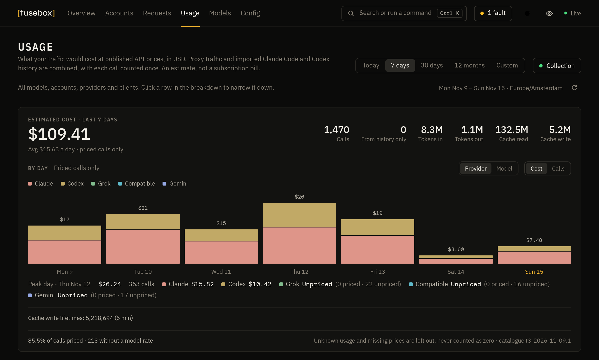
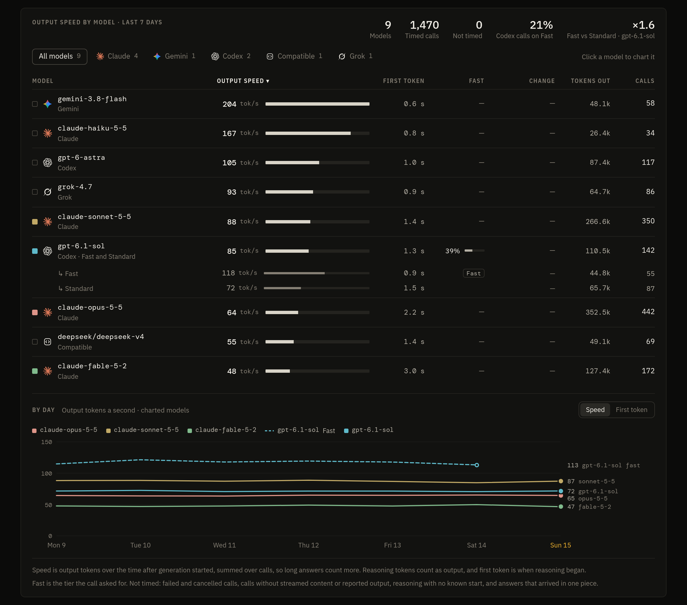
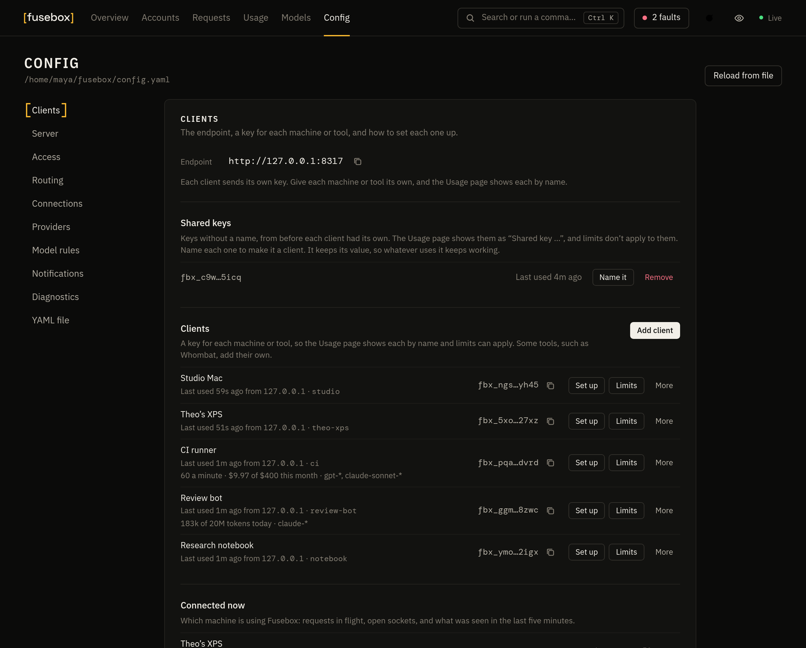
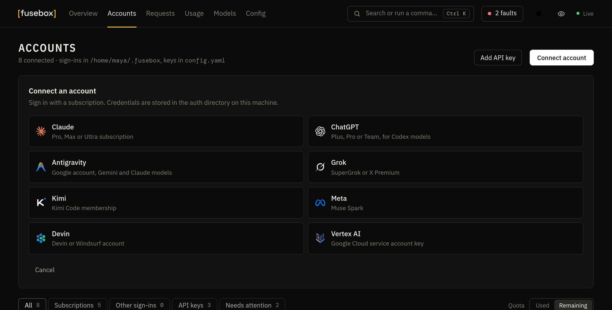

<div align="center">

<h1><picture><source media="(prefers-color-scheme: dark)" srcset="assets/fusebox-wordmark.svg"></picture></h1>

**All your AI subscriptions. One fast API.**

A single Rust binary that exposes OpenAI, Anthropic and Gemini compatible endpoints, backed by the accounts you already pay for:<br>
Claude, ChatGPT, Gemini, Antigravity, Grok, Kimi, Meta, Devin and Vertex AI.<br>
Point Claude Code, Codex, your editor or any SDK at one URL and stop caring which account answers.

[](https://github.com/DigitalPals/Fusebox/actions/workflows/ci.yml)
[](LICENSE)
[](https://www.rust-lang.org)
[](https://github.com/DigitalPals/Fusebox/releases/latest)
[](#the-dashboard)

[Install](#install) · [Connect your tools](#connect-your-tools) · [Dashboard](#the-dashboard) · [Configuration](#configuration) · [Docs](#documentation) · [FAQ](#faq)

</div>

<br>



<br>

## Why Fusebox

- **One small binary.** The dashboard and SQLite storage are built in. No Docker, Node or runtime to install.
- **Any model from any tool.** GPT in Claude Code, Claude in Codex, Gemini behind the OpenAI SDK. Fusebox translates between formats; when the client and the provider already speak the same one, the request passes through as sent.
- **Ten providers.** Sign in with Claude, ChatGPT, Antigravity, Grok, Kimi, Meta and Devin subscriptions or a Vertex AI service account, or add API keys for Anthropic, OpenAI, Gemini, Vertex, Kimi, xAI, Meta and anything OpenAI-compatible.
- **Many accounts, no babysitting.** Each new coding session goes to the account with the most quota left and stays there, so its prompt cache keeps paying off. Used-up accounts sit out until they reset, failed requests move to the next account (even mid-stream), and sign-ins refresh themselves.
- **A key per tool.** Each machine or tool gets its own key, with its own models, request rate, daily tokens, monthly budget and end date. Model groups give one name to several models that back each other up.
- **Images, video and WebSockets.** Image generation and edits, xAI video, and Codex's WebSocket sessions, relayed natively.
- **A dashboard you'll actually open.** Live 5-hour and weekly limits for every subscription, a forecast of whether the week's quota will last, a request log that explains each routing decision, cost per client, and a config editor. It works on a phone, and installs as an app with push notifications.
- **Drop-in for CLIProxyAPI.** Same credential files, `config.yaml`, Docker paths and flags.

## Install

Paste this into Claude Code, Codex or another coding agent on the machine that should run Fusebox:

```text
Install Fusebox on this machine by following
https://github.com/DigitalPals/Fusebox/blob/main/docs/install.md

- If CLIProxyAPI runs here, switch it to Fusebox as the guide's "Coming from
  CLIProxyAPI" section says, keeping my config and sign-ins. Otherwise download
  the latest release for this OS and CPU, check it against SHA256SUMS, and put
  `fusebox` on my PATH.
- Keep it running in the background (systemd on Linux, launchd on macOS,
  Task Scheduler on Windows), on 127.0.0.1:8317 only.
- Add a named client for this machine to config.yaml with a random fbx_ key,
  then point Claude Code and Codex at Fusebox with that key, as the README's
  "Connect your tools" section shows. Show me changes to my existing Claude
  Code or Codex settings before you make them.
- Ask me which subscriptions to add and run `fusebox login <provider>` for
  each one; I'll approve the sign-ins in my browser.
- Finish with `fusebox check` and give me the dashboard address.
```

Rather do it yourself? [docs/install.md](docs/install.md) has every step: the binary, Docker, coming from CLIProxyAPI, running on a server, and HTTPS with Tailscale, nginx or Caddy.

## Connect your tools

**Config → Clients** in the dashboard writes this setup for you, with the right key and model, for Claude Code, Codex, OpenCode, Gemini CLI, Aider, Continue, Zed, Cline, Roo Code, Cursor and more.

**Claude Code**

```sh
export ANTHROPIC_BASE_URL=http://127.0.0.1:8317
export ANTHROPIC_AUTH_TOKEN=<this machine's client key, or anything if you have no clients>
claude
```

Want GPT in Claude Code? `export ANTHROPIC_MODEL=gpt-6-astra`.

**Codex** in `~/.codex/config.toml`

```toml
model = "gpt-6-astra"
model_provider = "fusebox"

[model_providers.fusebox]
name = "Fusebox"
base_url = "http://127.0.0.1:8317/v1"
wire_api = "responses"
env_key = "FUSEBOX_KEY"   # only needed once you have clients
```

**OpenAI SDK**, or any tool with a custom OpenAI base URL

```python
from openai import OpenAI

client = OpenAI(base_url="http://127.0.0.1:8317/v1", api_key="<key>")
client.chat.completions.create(
    model="claude-sonnet-5-5",
    messages=[{"role": "user", "content": "Hello"}],
)
```

Fusebox speaks OpenAI Chat Completions and Responses (with WebSockets), Anthropic Messages, Gemini, OpenAI Images, embeddings and xAI video. A few model-name tricks work everywhere:

```text
gpt-6-astra(high)                  reasoning effort
claude-sonnet-4-5-20250929(16000)  thinking budget in tokens
antigravity/claude-sonnet-4-6      pick the provider yourself
gpt-6-1-sol                        forgiving names: finds gpt-6.1-sol
```

New models usually work straight away, and Claude and Codex accounts discover them by themselves. Every endpoint, provider and model rule is in [tools, endpoints and models](docs/api.md).

## The dashboard

Everything is served from the binary at `/`, with no external requests.

<table>
<tr>
<td width="50%" valign="top"></td>
<td width="50%" valign="top"></td>
</tr>
<tr>
<td valign="top"><b>Accounts:</b> 5-hour and weekly quota as segmented meters with an even-pace mark, when each resets, cooldowns per model, and a switch for each account.</td>
<td valign="top"><b>Each account:</b> its windows and which clients used them, its plan and renewal date, its hour of load, and the coding sessions pinned to it.</td>
</tr>
<tr>
<td valign="top"></td>
<td valign="top"></td>
</tr>
<tr>
<td valign="top"><b>Requests:</b> every request as it happens. Click one to see why it went to that account, which key sent it and from where.</td>
<td valign="top"><b>Usage:</b> what your traffic would cost at API list prices, by day, provider, model, account and client.</td>
</tr>
<tr>
<td colspan="2"></td>
</tr>
<tr>
<td colspan="2"><b>How fast each model answers:</b> output speed and time to first token per model, from the calls Fusebox served, with Codex Fast and Standard apart.</td>
</tr>
<tr>
<td valign="top"></td>
<td valign="top"></td>
</tr>
<tr>
<td valign="top"><b>A key for every client:</b> name a machine or tool, and Fusebox makes its key and shows its setup, last use and limits.</td>
<td valign="top"><b>Connect anything:</b> browser sign-in, device codes, or a Vertex service account. On a server, approve in your browser and paste the URL it lands on.</td>
</tr>
</table>

There is also a Models page with the route order for every model, a playground that can show what Fusebox would send without sending it, a privacy button that hides emails and keys for screenshots, a command palette (<kbd>⌘K</kbd>), light and dark themes, and English and Chinese. See [the dashboard](docs/dashboard.md) for all of it.

<sub>Screenshots use sample data.</sub>

## Configuration

`config.yaml` reloads by itself when it changes. The dashboard's Config page edits the same file and shows every change before it saves. A small example:

```yaml
host: "127.0.0.1"             # 0.0.0.0 to expose it (add a client first)
port: 8317
auth-dir: "~/.fusebox"        # sign-in files (CLIProxyAPI's work too)
management-key: ""            # empty = dashboard only from localhost
routing: least-used           # new sessions: most quota left; or smart-quota, round-robin, fill-first
named-clients:
  - id: laptop
    label: Work laptop
    key: fbx_...
    models: [claude-*, gpt-6-astra]
    usd-per-month: 100        # estimated at API list prices
model-groups:
  smart: [claude-opus-5-5, gpt-6-astra]   # one name; GPT takes over when Claude is out
gemini-api-key:
  - api-key: "AIza..."
```

- [Configuration](docs/configuration.md): every setting, client limits, model maps, model groups and account priority.
- [Routing, retries and sessions](docs/routing.md): how accounts are chosen, what happens when a request fails, and prompt caching.
- [Usage and costs](docs/usage-costs.md): the usage database, imports from Claude Code and Codex, and backups. Dollar figures are estimates at API list prices, never your subscription bill.

## Documentation

| | |
| --- | --- |
| [Install and run](docs/install.md) | Binary, Docker, CLIProxyAPI, servers, HTTPS, monitoring |
| [Tools, endpoints and models](docs/api.md) | Client setup, endpoints, providers, new models, images |
| [The dashboard](docs/dashboard.md) | Quota meters, forecast, notifications, banked resets |
| [Configuration](docs/configuration.md) | Settings, clients and their limits, model groups |
| [Routing, retries and sessions](docs/routing.md) | Account choice, failover, prompt caching |
| [Notifications](docs/notifications.md) · [Moving Fusebox](docs/moving.md) · [Source addresses](docs/source-addresses.md) | |
| [Development](docs/development.md) | Building, tests, client compatibility, releases |

## FAQ

**Is this allowed?** Fusebox is not affiliated with Anthropic, OpenAI, Google, xAI, Moonshot, Meta or Cognition. Using subscription accounts through third-party tools may be against a provider's terms, and providers can rate-limit or suspend accounts. You are responsible for how you use it.

**Where are my credentials stored?** In `auth-dir` (`~/.fusebox` by default, or `~/.cli-proxy-api` if only that exists), one file per account, readable only by you. On Windows, keep `auth-dir` inside your user profile. Nothing leaves your machine except requests to the providers you use.

**Does it phone home?** No. There is no telemetry and the dashboard loads no external assets. If you turn on notifications, Fusebox sends end-to-end encrypted messages to your browser's push service, and plain messages to the webhooks you add; nothing else.

**Claude sign-in fails or gets blocked.** Some Anthropic endpoints sit behind bot protection. If token exchange fails for you, please open an issue with the error from the dashboard.

**I used this project when it was called CLIProxyAPI-Rust.** Everything keeps working: the old `CLIPROXYAPI_RUST_*` variables, `x-cliproxy-*` headers and `~/.cli-proxy-api` are still read. Rename the binary in your scripts from `cliproxyapi-rust` to `fusebox`.

## Credits

Fusebox started as [CLIProxyAPI-Rust](https://github.com/IuCC123/CLIProxyAPI-Rust) by [IuCC123](https://github.com/IuCC123), who wrote the original Rust rewrite and dashboard. That project was in turn a rewrite of [CLIProxyAPI](https://github.com/router-for-me/CLIProxyAPI) by router-for-me. Thanks to both.

## License

[MIT](LICENSE): use, modify, distribute and sell it, including in proprietary software, while retaining the copyright and license notices. Unless explicitly stated otherwise, contributions submitted for inclusion are provided under MIT.

Code released through v0.6.1 remains available under the Unlicense. The transition does not revoke that grant or impose MIT's notice requirement on code already released under the Unlicense; see [NOTICE](NOTICE) for the exact commit boundary and original terms.

The bundled IBM Plex and DM Mono fonts remain under the SIL Open Font License 1.1; their notices are in [ui/fonts/OFL-IBMPlex.txt](ui/fonts/OFL-IBMPlex.txt) and [ui/fonts/OFL-DMMono.txt](ui/fonts/OFL-DMMono.txt). Binary archives and container images include these texts in `licenses/` alongside `NOTICE`.

The provider logos in `ui/logos.svg` come from [LobeHub Icons](https://github.com/lobehub/lobe-icons) (MIT, notice included in the file) and are trademarks of their owners.

<br>

<div align="center"><sub>Based on <a href="https://github.com/IuCC123/CLIProxyAPI-Rust">CLIProxyAPI-Rust</a> by IuCC123 and inspired by <a href="https://github.com/router-for-me/CLIProxyAPI">CLIProxyAPI</a>. Created in <a href="https://t3.codes">T3 Code</a>.</sub></div>
